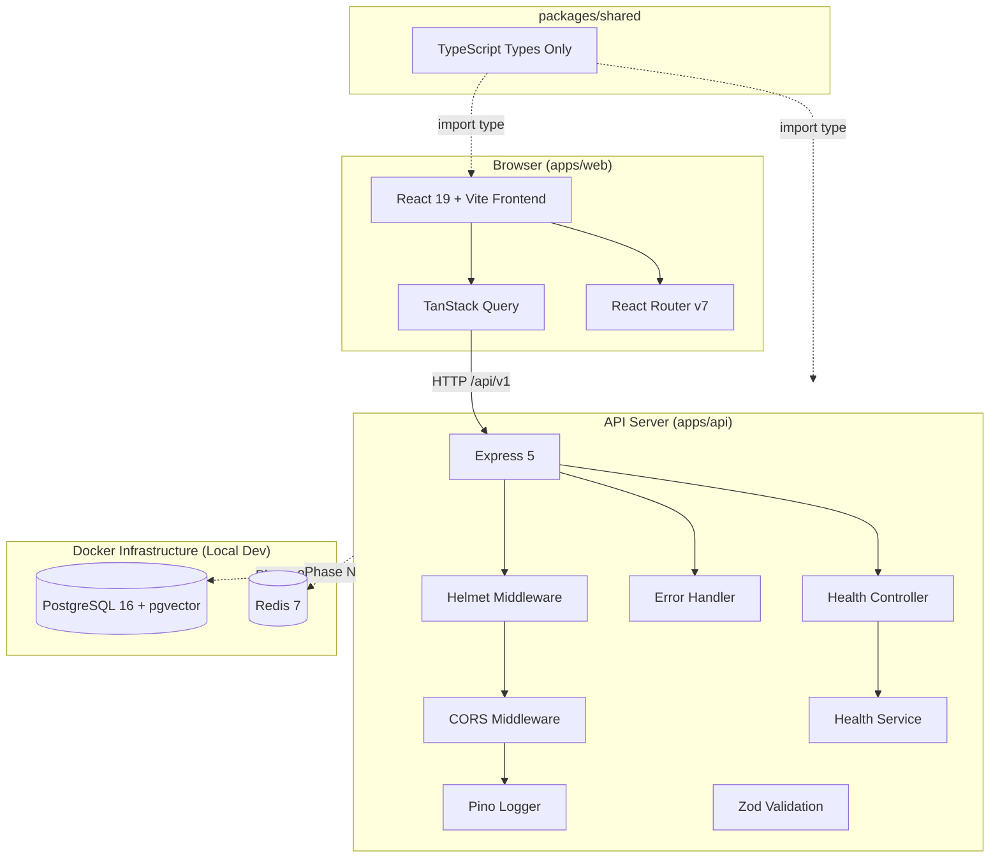

# Architecture Overview — CodeMind AI

## Architecture Diagram

## Monorepo Layout

- **apps/web**: React application running on Vite.
- **apps/api**: Express application with layered controller/service pattern.
- **packages/shared**: Shared DTOs and type contracts.
- **infrastructure/docker**: Docker compose and configuration definitions.
- **docs/**: Architectural diagrams and ADR records.
